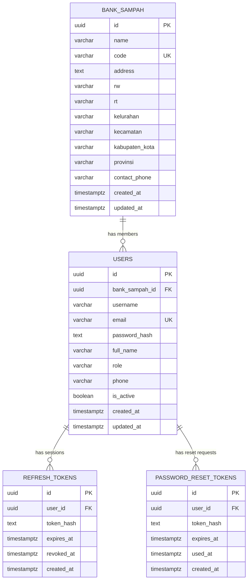
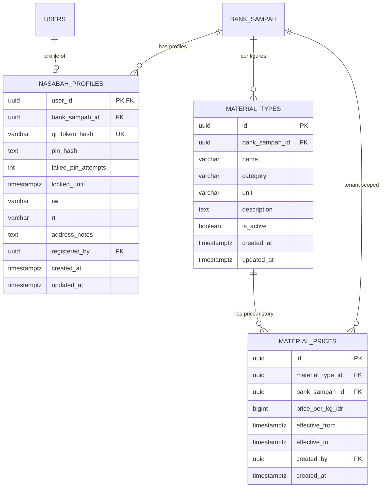
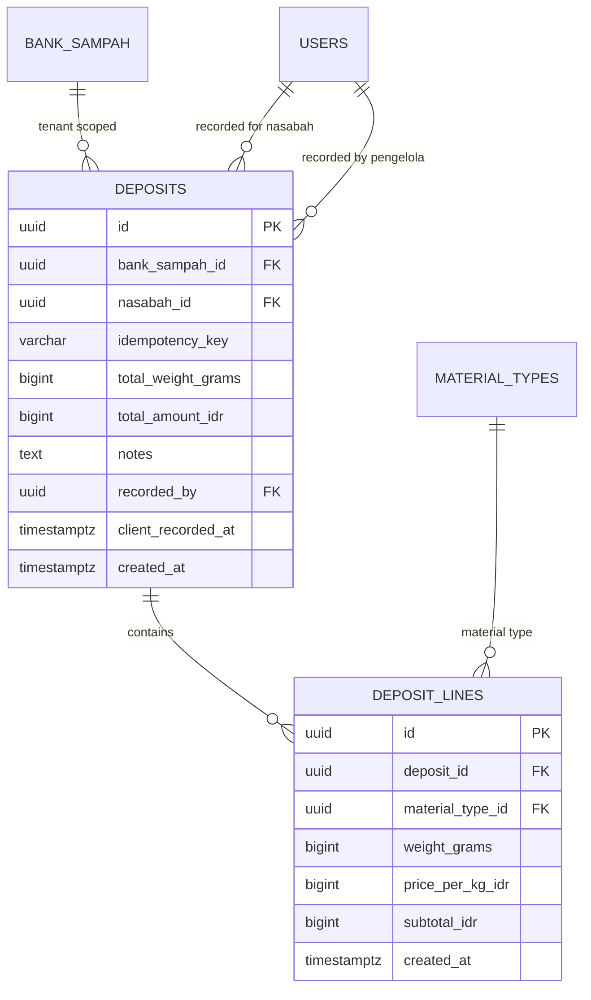

# Data Model — Setor Hijau

This document defines the relational database schema, conventions, and invariants for Setor Hijau.

---

## Conventions & Core Invariants

1. **Identifiers**: Primary keys use UUIDv4 via PostgreSQL `gen_random_uuid()`. Foreign keys match the target primary key type.
2. **Numeric Precision (Hard Rule #3)**:
   - **Currency (Money)**: Stored as `BIGINT` representing Indonesian Rupiah (IDR). No fractional rupiah. No floats.
   - **Weight**: Stored as `BIGINT` representing integer **grams** (e.g. 1.5 kg is stored as `1500`). No floats.
   - **Emissions**: Stored as `BIGINT` representing integer **grams of CO2 equivalent** (g CO2e) avoided. No floats.
3. **Timestamps**: All timestamps use `TIMESTAMPTZ` and default to `CURRENT_TIMESTAMP`. Application code always operates in UTC.
4. **Naming**:
   - Table names are `snake_case`, pluralized (e.g., `bank_sampah`, `users`, `refresh_tokens`, `deposits`).
   - Column names are `snake_case`.
   - Foreign keys follow the format `<singular_entity>_id` (e.g., `bank_sampah_id`, `user_id`).
5. **Multi-Tenancy (Hard Rule #1 & ADR 0004)**:
   - Every tenant-scoped table has a non-nullable `bank_sampah_id UUID REFERENCES bank_sampah(id)`.
   - Tenant isolation is enforced in application queries (`sqlc`) using context-injected `bank_sampah_id`.
   - Relational integrity is enforced by composite unique constraints and composite indexes: `(bank_sampah_id, id)` or `(bank_sampah_id, <field>)`.
6. **Immutability (Hard Rule #2)**:
   - Ledgers (`carbon_ledger`, `cashbook_entries`) and deposit records (`deposits`, `deposit_lines`) are append-only. No `UPDATE` or `DELETE` is permitted on committed transactions; corrections are done via explicit reversal records.

---

## Milestone 1 Schema (Tenancy & Authentication)

### 1. `bank_sampah` (Tenants)
Represents the Bank Sampah Unit (BSU) at the RW level.

| Column | Type | Constraints | Description |
|---|---|---|---|
| `id` | `UUID` | `PRIMARY KEY DEFAULT gen_random_uuid()` | Unique tenant identifier |
| `name` | `VARCHAR(255)` | `NOT NULL` | Name of the bank sampah (e.g., "Bank Sampah Hijau Lestari RW 05") |
| `code` | `VARCHAR(64)` | `NOT NULL UNIQUE` | Unique URL-safe identifier / slug (e.g., "bs-hijau-lestari-rw05") |
| `address` | `TEXT` | `NOT NULL` | Street address or base camp location |
| `rw` | `VARCHAR(10)` | `NOT NULL` | RW number |
| `rt` | `VARCHAR(10)` | `NULL` | Optional RT number |
| `kelurahan` | `VARCHAR(100)` | `NOT NULL` | Kelurahan / Desa |
| `kecamatan` | `VARCHAR(100)` | `NOT NULL` | Kecamatan |
| `kabupaten_kota` | `VARCHAR(100)` | `NOT NULL` | Kota / Kabupaten |
| `provinsi` | `VARCHAR(100)` | `NOT NULL` | Provinsi |
| `contact_phone` | `VARCHAR(32)` | `NULL` | Contact phone number (WhatsApp) |
| `created_at` | `TIMESTAMPTZ` | `NOT NULL DEFAULT CURRENT_TIMESTAMP` | Record creation timestamp |
| `updated_at` | `TIMESTAMPTZ` | `NOT NULL DEFAULT CURRENT_TIMESTAMP` | Record update timestamp |

### 2. `users`
Accounts for both `pengelola` and `nasabah`.

| Column | Type | Constraints | Description |
|---|---|---|---|
| `id` | `UUID` | `PRIMARY KEY DEFAULT gen_random_uuid()` | Unique user identifier |
| `bank_sampah_id` | `UUID` | `NOT NULL REFERENCES bank_sampah(id) ON DELETE CASCADE` | Associated tenant |
| `username` | `VARCHAR(64)` | `NOT NULL` | Login identifier |
| `email` | `VARCHAR(255)` | `NULL UNIQUE` | Unique email for Pengelola; optional for Nasabah |
| `password_hash` | `TEXT` | `NOT NULL` | Argon2id hashed password |
| `full_name` | `VARCHAR(255)` | `NOT NULL` | Full name of the user |
| `role` | `VARCHAR(32)` | `NOT NULL` | Role: `pengelola` or `nasabah` |
| `phone` | `VARCHAR(32)` | `NULL` | Contact phone number |
| `is_active` | `BOOLEAN` | `NOT NULL DEFAULT TRUE` | Whether account is active |
| `created_at` | `TIMESTAMPTZ` | `NOT NULL DEFAULT CURRENT_TIMESTAMP` | Account creation timestamp |
| `updated_at` | `TIMESTAMPTZ` | `NOT NULL DEFAULT CURRENT_TIMESTAMP` | Profile update timestamp |

*Indexes and Constraints:*
- `UNIQUE (bank_sampah_id, username)`: Usernames are unique within each bank sampah for Nasabah.
- `CREATE INDEX idx_users_bank_sampah ON users(bank_sampah_id);`
- `CREATE INDEX idx_users_username ON users(username);`
- `CREATE INDEX idx_users_role ON users(role);`

### 3. `refresh_tokens`
Tracks rotating refresh token sessions.

| Column | Type | Constraints | Description |
|---|---|---|---|
| `id` | `UUID` | `PRIMARY KEY DEFAULT gen_random_uuid()` | Session ID |
| `user_id` | `UUID` | `NOT NULL REFERENCES users(id) ON DELETE CASCADE` | User owning the session |
| `token_hash` | `TEXT` | `NOT NULL UNIQUE` | SHA-256 hash of the opaque token string |
| `expires_at` | `TIMESTAMPTZ` | `NOT NULL` | Expiry timestamp (typically +7 days) |
| `revoked_at` | `TIMESTAMPTZ` | `NULL` | Revocation timestamp if logged out or rotated |
| `created_at` | `TIMESTAMPTZ` | `NOT NULL DEFAULT CURRENT_TIMESTAMP` | Issuance timestamp |

*Indexes and Constraints:*
- `CREATE INDEX idx_refresh_tokens_user_id ON refresh_tokens(user_id);`
- `CREATE INDEX idx_refresh_tokens_token_hash ON refresh_tokens(token_hash);`

### 4. `password_reset_tokens`
Self-service recovery tokens for Pengelola accounts.

| Column | Type | Constraints | Description |
|---|---|---|---|
| `id` | `UUID` | `PRIMARY KEY DEFAULT gen_random_uuid()` | Reset request ID |
| `user_id` | `UUID` | `NOT NULL REFERENCES users(id) ON DELETE CASCADE` | User requesting reset |
| `token_hash` | `TEXT` | `NOT NULL UNIQUE` | SHA-256 hash of the single-use token |
| `expires_at` | `TIMESTAMPTZ` | `NOT NULL` | Expiration (typically +15 minutes) |
| `used_at` | `TIMESTAMPTZ` | `NULL` | Timestamp when the token was used |
| `created_at` | `TIMESTAMPTZ` | `NOT NULL DEFAULT CURRENT_TIMESTAMP` | Issuance timestamp |

---

## Milestone 2 Schema (Nasabah & Master Data)

### 5. `nasabah_profiles`
Metadata, QR identification token hash, and PIN security for accounts with role `nasabah`.

| Column | Type | Constraints | Description |
|---|---|---|---|
| `user_id` | `UUID` | `PRIMARY KEY REFERENCES users(id) ON DELETE CASCADE` | User account |
| `bank_sampah_id` | `UUID` | `NOT NULL REFERENCES bank_sampah(id) ON DELETE CASCADE` | Associated tenant |
| `qr_token_hash` | `VARCHAR(64)` | `NOT NULL UNIQUE` | SHA-256 hash of the 32-byte opaque QR token string |
| `pin_hash` | `TEXT` | `NULL` | Argon2id hash of the optional 6-digit PIN |
| `failed_pin_attempts` | `INT` | `NOT NULL DEFAULT 0` | Consecutive failed PIN attempts |
| `locked_until` | `TIMESTAMPTZ` | `NULL` | Temporary lockout timestamp after 5 failed attempts |
| `rw` | `VARCHAR(10)` | `NOT NULL` | Neighborhood unit (RW) |
| `rt` | `VARCHAR(10)` | `NULL` | Neighborhood unit (RT) |
| `address_notes` | `TEXT` | `NULL` | Optional address or house number notes |
| `registered_by` | `UUID` | `NULL REFERENCES users(id) ON DELETE SET NULL` | Pengelola who created this account |
| `created_at` | `TIMESTAMPTZ` | `NOT NULL DEFAULT CURRENT_TIMESTAMP` | Profile creation timestamp |
| `updated_at` | `TIMESTAMPTZ` | `NOT NULL DEFAULT CURRENT_TIMESTAMP` | Profile update timestamp |

*Indexes and Constraints:*
- `CREATE INDEX idx_nasabah_profiles_bank_sampah ON nasabah_profiles(bank_sampah_id);`
- `CREATE INDEX idx_nasabah_profiles_qr_token_hash ON nasabah_profiles(qr_token_hash);`

### 6. `material_types`
Master data of recyclable waste categories accepted by a bank sampah.

| Column | Type | Constraints | Description |
|---|---|---|---|
| `id` | `UUID` | `PRIMARY KEY DEFAULT gen_random_uuid()` | Unique material identifier |
| `bank_sampah_id` | `UUID` | `NOT NULL REFERENCES bank_sampah(id) ON DELETE CASCADE` | Associated tenant |
| `name` | `VARCHAR(100)` | `NOT NULL` | Name of the material (e.g., "Kardus Bekas", "Botol PET") |
| `category` | `VARCHAR(50)` | `NOT NULL` | Category group (e.g. `kertas`, `plastik`, `logam`, `kaca`, `lainnya`) |
| `unit` | `VARCHAR(20)` | `NOT NULL DEFAULT 'kg'` | Display unit (default `kg`) |
| `description` | `TEXT` | `NULL` | Sorting guidelines or notes |
| `is_active` | `BOOLEAN` | `NOT NULL DEFAULT TRUE` | Active for deposit recording |
| `created_at` | `TIMESTAMPTZ` | `NOT NULL DEFAULT CURRENT_TIMESTAMP` | Record creation timestamp |
| `updated_at` | `TIMESTAMPTZ` | `NOT NULL DEFAULT CURRENT_TIMESTAMP` | Record update timestamp |

*Indexes and Constraints:*
- `CONSTRAINT uq_material_types_bank_sampah_name UNIQUE (bank_sampah_id, name)`
- `CREATE INDEX idx_material_types_bank_sampah ON material_types(bank_sampah_id);`

### 7. `material_prices`
Append-only historical prices per kilogram in integer Rupiah (Hard Rule #3).

| Column | Type | Constraints | Description |
|---|---|---|---|
| `id` | `UUID` | `PRIMARY KEY DEFAULT gen_random_uuid()` | Unique price entry ID |
| `material_type_id` | `UUID` | `NOT NULL REFERENCES material_types(id) ON DELETE CASCADE` | Material reference |
| `bank_sampah_id` | `UUID` | `NOT NULL REFERENCES bank_sampah(id) ON DELETE CASCADE` | Tenant reference |
| `price_per_kg_idr` | `BIGINT` | `NOT NULL CHECK (price_per_kg_idr >= 0)` | Price per kilogram in IDR |
| `effective_from` | `TIMESTAMPTZ` | `NOT NULL DEFAULT CURRENT_TIMESTAMP` | When price takes effect |
| `effective_to` | `TIMESTAMPTZ` | `NULL` | When price ceased (`NULL` = currently active) |
| `created_by` | `UUID` | `NULL REFERENCES users(id) ON DELETE SET NULL` | Pengelola who set this price |
| `created_at` | `TIMESTAMPTZ` | `NOT NULL DEFAULT CURRENT_TIMESTAMP` | Entry creation timestamp |

*Indexes and Constraints:*
- `CREATE INDEX idx_material_prices_material_type ON material_prices(material_type_id);`
- `CREATE INDEX idx_material_prices_bank_sampah ON material_prices(bank_sampah_id);`
- `CREATE INDEX idx_material_prices_effective ON material_prices(material_type_id, effective_to);`

---

## Milestone 3 Schema (Deposits & Balance)

### 8. `deposits`
Immutable header record for waste deposits (Hard Rule #2 & Hard Rule #5).

| Column | Type | Constraints | Description |
|---|---|---|---|
| `id` | `UUID` | `PRIMARY KEY DEFAULT gen_random_uuid()` | Unique deposit transaction ID |
| `bank_sampah_id` | `UUID` | `NOT NULL REFERENCES bank_sampah(id) ON DELETE CASCADE` | Associated tenant |
| `nasabah_id` | `UUID` | `NOT NULL REFERENCES users(id) ON DELETE RESTRICT` | Customer who deposited waste |
| `idempotency_key` | `VARCHAR(64)` | `NOT NULL` | Client-generated UUID for offline deduplication |
| `total_weight_grams` | `BIGINT` | `NOT NULL CHECK (total_weight_grams >= 0)` | Aggregated weight in integer grams |
| `total_amount_idr` | `BIGINT` | `NOT NULL CHECK (total_amount_idr >= 0)` | Aggregated value in integer Rupiah |
| `notes` | `TEXT` | `NULL` | Optional transaction notes |
| `recorded_by` | `UUID` | `NOT NULL REFERENCES users(id) ON DELETE RESTRICT` | Officer/Pengelola who entered transaction |
| `client_recorded_at` | `TIMESTAMPTZ` | `NOT NULL` | Time when physical deposit happened on device |
| `created_at` | `TIMESTAMPTZ` | `NOT NULL DEFAULT CURRENT_TIMESTAMP` | Server receipt and persistence timestamp |

*Indexes and Constraints:*
- `CONSTRAINT uq_deposits_bank_sampah_idempotency UNIQUE (bank_sampah_id, idempotency_key)`
- `CREATE INDEX idx_deposits_bank_sampah ON deposits(bank_sampah_id);`
- `CREATE INDEX idx_deposits_nasabah ON deposits(nasabah_id);`
- `CREATE INDEX idx_deposits_bank_sampah_nasabah ON deposits(bank_sampah_id, nasabah_id);`
- `CREATE INDEX idx_deposits_client_recorded ON deposits(bank_sampah_id, client_recorded_at DESC);`

### 9. `deposit_lines`
Immutable itemized waste lines with permanently snapshotted prices (Hard Rule #3 & Invariant #4).

| Column | Type | Constraints | Description |
|---|---|---|---|
| `id` | `UUID` | `PRIMARY KEY DEFAULT gen_random_uuid()` | Unique line item ID |
| `deposit_id` | `UUID` | `NOT NULL REFERENCES deposits(id) ON DELETE CASCADE` | Parent deposit transaction |
| `material_type_id` | `UUID` | `NOT NULL REFERENCES material_types(id) ON DELETE RESTRICT` | Material reference |
| `weight_grams` | `BIGINT` | `NOT NULL CHECK (weight_grams > 0)` | Weight in integer grams |
| `price_per_kg_idr` | `BIGINT` | `NOT NULL CHECK (price_per_kg_idr >= 0)` | Historical price per kg snapshotted at `client_recorded_at` |
| `subtotal_idr` | `BIGINT` | `NOT NULL CHECK (subtotal_idr >= 0)` | Subtotal: `(weight_grams * price_per_kg_idr + 500) / 1000` |
| `created_at` | `TIMESTAMPTZ` | `NOT NULL DEFAULT CURRENT_TIMESTAMP` | Line creation timestamp |

*Indexes and Constraints:*
- `CREATE INDEX idx_deposit_lines_deposit ON deposit_lines(deposit_id);`
- `CREATE INDEX idx_deposit_lines_material ON deposit_lines(material_type_id);`

---

## Preview: Subsequent Milestone Entities

The following entities are planned for upcoming milestones and will be migrated incrementally:

- **M4 (Carbon Ledger)**:
  - `emission_factors`: EPA WARM versioned factors (`id`, `material_code`, `factor_version`, `factor_source`, `co2e_per_gram`).
  - `carbon_ledger`: Append-only environmental journal (`id`, `bank_sampah_id`, `nasabah_id`, `deposit_id`, `factor_id`, `co2e_grams`, `entry_type`, `created_at`).
- **M5 (Cashbook)**:
  - `cashbook_entries`: Financial journal (`id`, `bank_sampah_id`, `deposit_id`, `entry_type`, `amount_idr`, `balance_after_idr`, `description`, `created_at`).
- **M6 (Net Impact Meter)**:
  - `digital_footprint_measurements`: SWDM v4 web digital footprint logs (`id`, `data_bytes_transferred`, `co2e_grams`, `period_start`, `period_end`).
