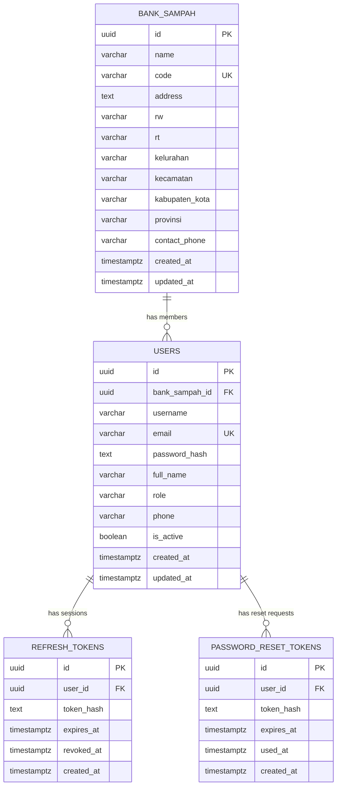

# Data Model — Setor Hijau

This document defines the relational database schema, conventions, and invariants for Setor Hijau.

---

## Conventions & Core Invariants

1. **Identifiers**: Primary keys use UUIDv4 via PostgreSQL `gen_random_uuid()`. Foreign keys match the target primary key type.
2. **Numeric Precision (Hard Rule #3)**:
   - **Currency (Money)**: Stored as `BIGINT` representing Indonesian Rupiah (IDR). No fractional rupiah. No floats.
   - **Weight**: Stored as `BIGINT` representing integer **grams** (e.g. 1.5 kg is stored as `1500`). No floats.
   - **Emissions**: Stored as `BIGINT` representing integer **grams of CO2 equivalent** (g CO2e) avoided. No floats.
3. **Timestamps**: All timestamps use `TIMESTAMPTZ` and default to `CURRENT_TIMESTAMP`. Application code always operates in UTC.
4. **Naming**:
   - Table names are `snake_case`, pluralized (e.g., `bank_sampah`, `users`, `refresh_tokens`, `deposits`).
   - Column names are `snake_case`.
   - Foreign keys follow the format `<singular_entity>_id` (e.g., `bank_sampah_id`, `user_id`).
5. **Multi-Tenancy (Hard Rule #1 & ADR 0004)**:
   - Every tenant-scoped table has a non-nullable `bank_sampah_id UUID REFERENCES bank_sampah(id)`.
   - Tenant isolation is enforced in application queries (`sqlc`) using context-injected `bank_sampah_id`.
   - Relational integrity is enforced by composite unique constraints and composite indexes: `(bank_sampah_id, id)` or `(bank_sampah_id, <field>)`.
6. **Immutability (Hard Rule #2)**:
   - Ledgers (`carbon_ledger`, `cashbook_entries`) and deposit records (`deposits`, `deposit_lines`) are append-only. No `UPDATE` or `DELETE` is permitted on committed transactions; corrections are done via explicit reversal records.

---

## Milestone 1 Schema (Tenancy & Authentication)

### 1. `bank_sampah` (Tenants)
Represents the Bank Sampah Unit (BSU) at the RW level.

| Column | Type | Constraints | Description |
|---|---|---|---|
| `id` | `UUID` | `PRIMARY KEY DEFAULT gen_random_uuid()` | Unique tenant identifier |
| `name` | `VARCHAR(255)` | `NOT NULL` | Name of the bank sampah (e.g., "Bank Sampah Hijau Lestari RW 05") |
| `code` | `VARCHAR(64)` | `NOT NULL UNIQUE` | Unique URL-safe identifier / slug (e.g., "bs-hijau-lestari-rw05") |
| `address` | `TEXT` | `NOT NULL` | Street address or base camp location |
| `rw` | `VARCHAR(10)` | `NOT NULL` | RW number |
| `rt` | `VARCHAR(10)` | `NULL` | Optional RT number |
| `kelurahan` | `VARCHAR(100)` | `NOT NULL` | Kelurahan / Desa |
| `kecamatan` | `VARCHAR(100)` | `NOT NULL` | Kecamatan |
| `kabupaten_kota` | `VARCHAR(100)` | `NOT NULL` | Kota / Kabupaten |
| `provinsi` | `VARCHAR(100)` | `NOT NULL` | Provinsi |
| `contact_phone` | `VARCHAR(32)` | `NULL` | Contact phone number (WhatsApp) |
| `created_at` | `TIMESTAMPTZ` | `NOT NULL DEFAULT CURRENT_TIMESTAMP` | Record creation timestamp |
| `updated_at` | `TIMESTAMPTZ` | `NOT NULL DEFAULT CURRENT_TIMESTAMP` | Record update timestamp |

### 2. `users`
Accounts for both `pengelola` and `nasabah`.

| Column | Type | Constraints | Description |
|---|---|---|---|
| `id` | `UUID` | `PRIMARY KEY DEFAULT gen_random_uuid()` | Unique user identifier |
| `bank_sampah_id` | `UUID` | `NOT NULL REFERENCES bank_sampah(id) ON DELETE CASCADE` | Associated tenant |
| `username` | `VARCHAR(64)` | `NOT NULL` | Login identifier |
| `email` | `VARCHAR(255)` | `NULL UNIQUE` | Unique email for Pengelola; optional for Nasabah |
| `password_hash` | `TEXT` | `NOT NULL` | Argon2id hashed password |
| `full_name` | `VARCHAR(255)` | `NOT NULL` | Full name of the user |
| `role` | `VARCHAR(32)` | `NOT NULL` | Role: `pengelola` or `nasabah` |
| `phone` | `VARCHAR(32)` | `NULL` | Contact phone number |
| `is_active` | `BOOLEAN` | `NOT NULL DEFAULT TRUE` | Whether account is active |
| `created_at` | `TIMESTAMPTZ` | `NOT NULL DEFAULT CURRENT_TIMESTAMP` | Account creation timestamp |
| `updated_at` | `TIMESTAMPTZ` | `NOT NULL DEFAULT CURRENT_TIMESTAMP` | Profile update timestamp |

*Indexes and Constraints:*
- `UNIQUE (bank_sampah_id, username)`: Usernames are unique within each bank sampah for Nasabah.
- `CREATE INDEX idx_users_bank_sampah ON users(bank_sampah_id);`
- `CREATE INDEX idx_users_username ON users(username);`
- `CREATE INDEX idx_users_role ON users(role);`

### 3. `refresh_tokens`
Tracks rotating refresh token sessions.

| Column | Type | Constraints | Description |
|---|---|---|---|
| `id` | `UUID` | `PRIMARY KEY DEFAULT gen_random_uuid()` | Session ID |
| `user_id` | `UUID` | `NOT NULL REFERENCES users(id) ON DELETE CASCADE` | User owning the session |
| `token_hash` | `TEXT` | `NOT NULL UNIQUE` | SHA-256 hash of the opaque token string |
| `expires_at` | `TIMESTAMPTZ` | `NOT NULL` | Expiry timestamp (typically +7 days) |
| `revoked_at` | `TIMESTAMPTZ` | `NULL` | Revocation timestamp if logged out or rotated |
| `created_at` | `TIMESTAMPTZ` | `NOT NULL DEFAULT CURRENT_TIMESTAMP` | Issuance timestamp |

*Indexes and Constraints:*
- `CREATE INDEX idx_refresh_tokens_user_id ON refresh_tokens(user_id);`
- `CREATE INDEX idx_refresh_tokens_token_hash ON refresh_tokens(token_hash);`

### 4. `password_reset_tokens`
Self-service recovery tokens for Pengelola accounts.

| Column | Type | Constraints | Description |
|---|---|---|---|
| `id` | `UUID` | `PRIMARY KEY DEFAULT gen_random_uuid()` | Reset request ID |
| `user_id` | `UUID` | `NOT NULL REFERENCES users(id) ON DELETE CASCADE` | User requesting reset |
| `token_hash` | `TEXT` | `NOT NULL UNIQUE` | SHA-256 hash of the single-use token |
| `expires_at` | `TIMESTAMPTZ` | `NOT NULL` | Expiration (typically +15 minutes) |
| `used_at` | `TIMESTAMPTZ` | `NULL` | Timestamp when the token was used |
| `created_at` | `TIMESTAMPTZ` | `NOT NULL DEFAULT CURRENT_TIMESTAMP` | Issuance timestamp |

---

## Preview: Subsequent Milestone Entities

The following entities are planned for upcoming milestones and will be migrated incrementally:

- **M2 (Nasabah & Master Data)**:
  - `nasabah_profiles`: Additional metadata for nasabah (`qr_token_hash`, `pin_hash`, `rw`, `rt`, `registered_by`).
  - `material_types`: Waste categories (`bank_sampah_id`, `name`, `unit`, `is_active`).
  - `material_prices`: Price history (`material_type_id`, `price_per_unit_idr`, `effective_from`, `effective_to`).
- **M3 (Deposits & Balance)**:
  - `deposits`: Deposit transactions (`id`, `bank_sampah_id`, `nasabah_id`, `idempotency_key`, `total_amount_idr`, `client_recorded_at`, `created_at`).
  - `deposit_lines`: Line items (`deposit_id`, `material_type_id`, `weight_grams`, `price_per_kg_idr`, `subtotal_idr`, `co2e_avoided_grams`).
- **M4 (Carbon Ledger)**:
  - `emission_factors`: EPA WARM versioned factors (`id`, `material_code`, `factor_version`, `factor_source`, `co2e_per_gram`).
  - `carbon_ledger`: Append-only environmental journal (`id`, `bank_sampah_id`, `nasabah_id`, `deposit_id`, `factor_id`, `co2e_grams`, `entry_type`, `created_at`).
- **M5 (Cashbook)**:
  - `cashbook_entries`: Financial journal (`id`, `bank_sampah_id`, `deposit_id`, `entry_type`, `amount_idr`, `balance_after_idr`, `description`, `created_at`).
- **M6 (Net Impact Meter)**:
  - `digital_footprint_measurements`: SWDM v4 web digital footprint logs (`id`, `data_bytes_transferred`, `co2e_grams`, `period_start`, `period_end`).
